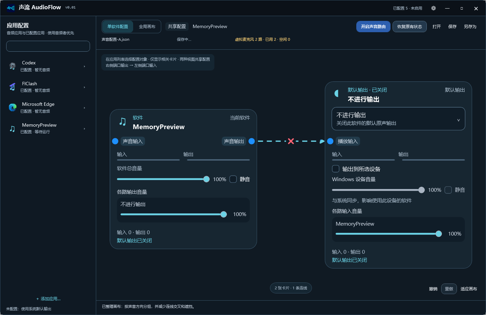

# 声流 AudioFlow

Windows 11 上的节点式软件音频路由器。支持每个应用到任意多个输出、
两路独立虚拟麦克风、真实麦克风混入、撤销与场景保存。播放去向由连线决定。
单软件配置和全局画布共享同一张路由图，分别用于查看相关卡片与全部卡片。
任一视图的修改都会同步，切换视图不改变正在执行的声音路由。
运行区只有开启／停止声音路由，视图选择独立；运行中的连线、音量与静音修改实时生效。
支持打开、保存、另存为和自动保存当前文件；停止后仍可编辑，重开恢复上次文件和开停状态。
应用列表用于配置导航；画布右键添加卡片，卡片内选择具体软件或设备。
左侧优先显示正在使用音频的应用，并保留已配置、手动添加及有音频会话证据的应用。
其他应用可按名称搜索，在三列卡片网格中手动添加。
单软件配置固定当前软件卡片，并显示它独有的默认输出卡片和受保护连线。
在默认输出卡片中更换设备会改变这个软件的原声输出；新增播放设备连接复制声音。
默认输出下拉框提供“不进行输出”，与“输出到所选设备”开关同步；其他输出继续运行。
开关状态会保存，重新开启会保留设备和连线音量。
卡片支持各条输入／输出连接的独立音量，扬声器设备音量与 Windows 双向同步。
普通输入端可拖线改接，保留原音量；双击普通连接线或音量行的“×”可断开。
当前软件、默认输出卡片及默认连线受保护；额外添加的软件和设备可自由配置。
关闭窗口默认退出并自动还原声流介入前的声音设置；界面和托盘均提供“恢复原有状态”。
已关闭应用的恢复记录会保留，重新播放时自动还原；退出后的临时恢复助手完成剩余还原即退出。

运行说明见 [使用说明](docs/使用说明.md)。

## 下载

当前版本 [v0.02](https://github.com/16Mu/AudioFlow/releases/tag/v0.02)，适用于 Windows 11 x64。

- [MSI 安装包](https://github.com/16Mu/AudioFlow/releases/download/v0.02/AudioFlow-0.02-x64.msi)
- [便携 ZIP](https://github.com/16Mu/AudioFlow/releases/download/v0.02/AudioFlow-0.02-portable.zip)：解压后打开 `portable/AudioFlow.exe`。
- [源码 ZIP](https://github.com/16Mu/AudioFlow/releases/download/v0.02/AudioFlow-0.02-source.zip)

运行前安装 [.NET 10 桌面运行时（x64）](https://dotnet.microsoft.com/download/dotnet/10.0)。
虚拟麦克风需要自行安装兼容的虚拟音频驱动，详见使用说明。
更新内容见 [发布说明](docs/发布说明.md)，验证结果与限制见 [验证报告](docs/验证报告.md)。

## 首次使用

首次打开会显示三步引导：认识声流、学习连接声音、按需要准备虚拟音频驱动。
可以选择“跳过引导，先看看”或“暂不安装，先看看”，之后不会重复弹出。
在设置中点击“查看新手引导”可以重新打开；“驱动下载与安装”提供 VB-CABLE 和 Hi-Fi CABLE 的官方下载按钮、已检测状态及安装入口。
只调整软件的播放去向可以直接使用。需要软件间的麦克风输入时，再下载并完整解压官方 ZIP，点击“安装已下载的驱动…”选择其中的安装程序，完成后重新检测设备。

## 构建

工具链由 vsm 管理。依赖使用 NuGet 与本地 .NET 工具清单。

    vsm current
    vsm list dotnet
    dotnet tool restore
    .\scripts\build.ps1 -Verify

公开版本 v0.02。构建输出为 dist\AudioFlow-0.02：MSI、便携 ZIP、源码 ZIP、使用说明、发布说明与校验文件。
发布为框架依赖的 .NET 10 软件，不在项目内安装运行时副本。
旧版含 Mode 与两份画布配置的工作区会先保存 workspace.json.pre-migration，再合并为共享配置。

当前开发机 vsm 的 10.0.102 纳管路径实际含
11.0.100-rc.2.26504.105 SDK；global.json 为本机锁定该可用 SDK。
软件目标运行时为稳定 .NET 10。更换开发机时应按实际已纳管 SDK 调整 global.json。

## 验证

    dotnet build tests/AudioFlow.Verification -c Release
    .\tests\AudioFlow.Verification\bin\Release\net10.0-windows10.0.22000.0\AudioFlow.Verification.exe --unit
    .\tests\AudioFlow.Verification\bin\Release\net10.0-windows10.0.22000.0\AudioFlow.Verification.exe --channel-tests
    .\tests\AudioFlow.Verification\bin\Release\net10.0-windows10.0.22000.0\AudioFlow.Verification.exe --live 1800

新手引导与设置检查：

    .\src\AudioFlow.App\bin\Release\net10.0-windows10.0.22000.0\win-x64\AudioFlow.exe --verify-onboarding .cache\onboarding-check
    .\src\AudioFlow.App\bin\Release\net10.0-windows10.0.22000.0\win-x64\AudioFlow.exe --verify-settings .cache\settings-check

界面验证使用 --verify-ui <报告目录>，会启动自有测试音程序并走实际退出与还原流程，
同时验证已关闭应用重开、无音频会话时保留恢复记录及退出后的恢复助手。

真实音频验证使用两种不同频率的合成信号，检查四路输出矩阵、音量、
按连线停止耳机输出、两路麦克风隔离、静音及退出恢复。只记录统计数据，不保存录音。
本机 live 验证选择内置扬声器、Steam 虚拟输出和两路虚拟音频线；
其他硬件组合可调整验证器中的设备选择。

## 结构

- AudioFlow.Core：共享路由图、工作区与导入导出、校验、有界音频缓冲。
- AudioFlow.Audio：按进程树捕获、设备混音、Windows 输出偏好与恢复日志。
- AudioFlow.App：WPF / Nodify 节点界面与托盘。
- AudioFlow.Verification：纯逻辑检查与真实音频信号验证。

[App Audio Router 参考项目](https://github.com/Eververdants/AppAudioRouter)。
第三方许可见 THIRD_PARTY_NOTICES.md。图谱与工具链记录见 docs/IMPLEMENTATION.md。
主题颜色、字体与圆角统一由 src/AudioFlow.App/Themes/Tokens.xaml 管理，共享控件模板见 Themes/Controls.xaml。
主题检查会拒绝视图中的硬编码颜色，并验证正常、悬停、选中与禁用文字对比度至少为 4.5:1。

录音软件卡片可更改默认录音设备，“不进行输入”与开关同步。关闭录音使用一条空闲、无声音的独立虚拟通道，保持其他软件的录音。通道池根据已安装设备动态扩容，用尽时显示占用对象并明确选择是否共享混音。
