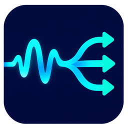
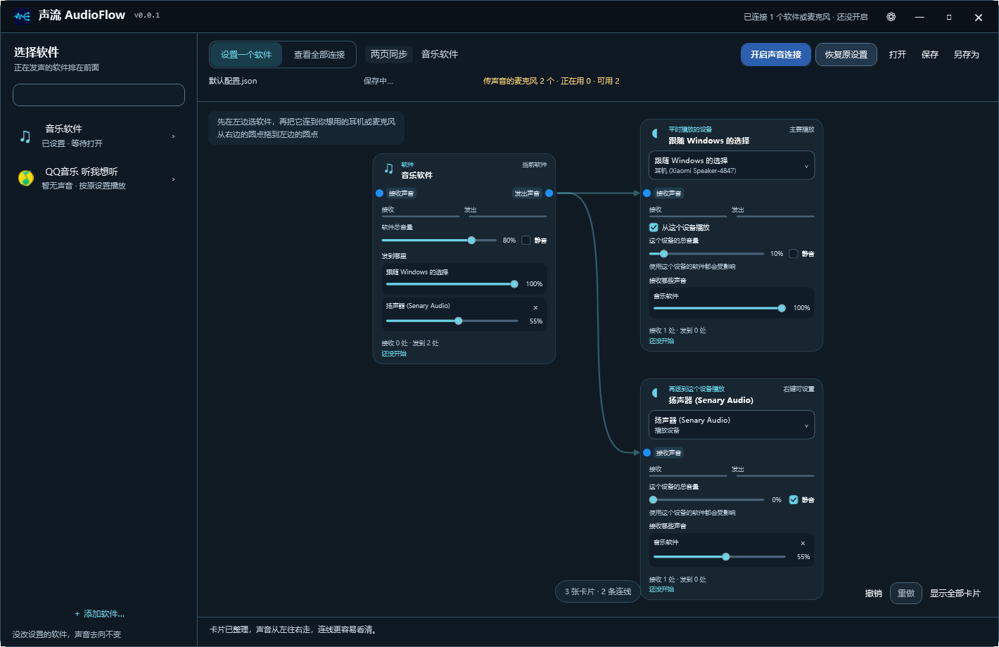
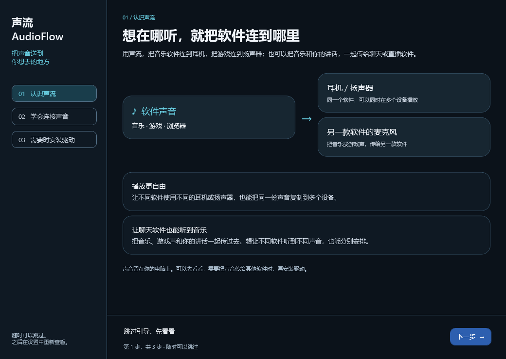
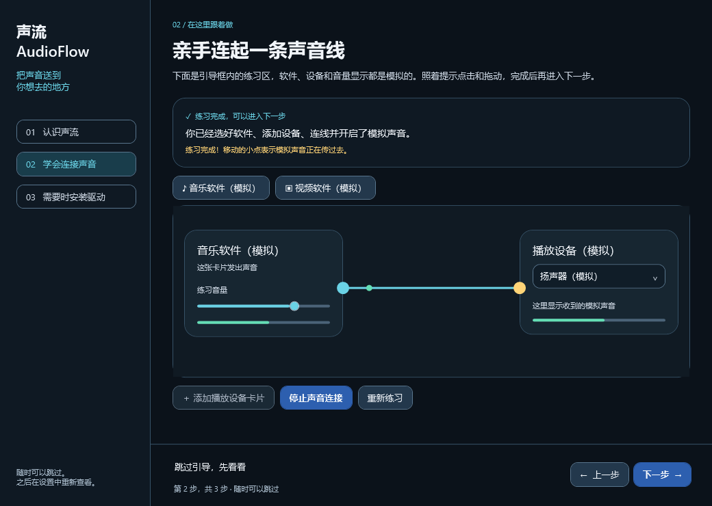
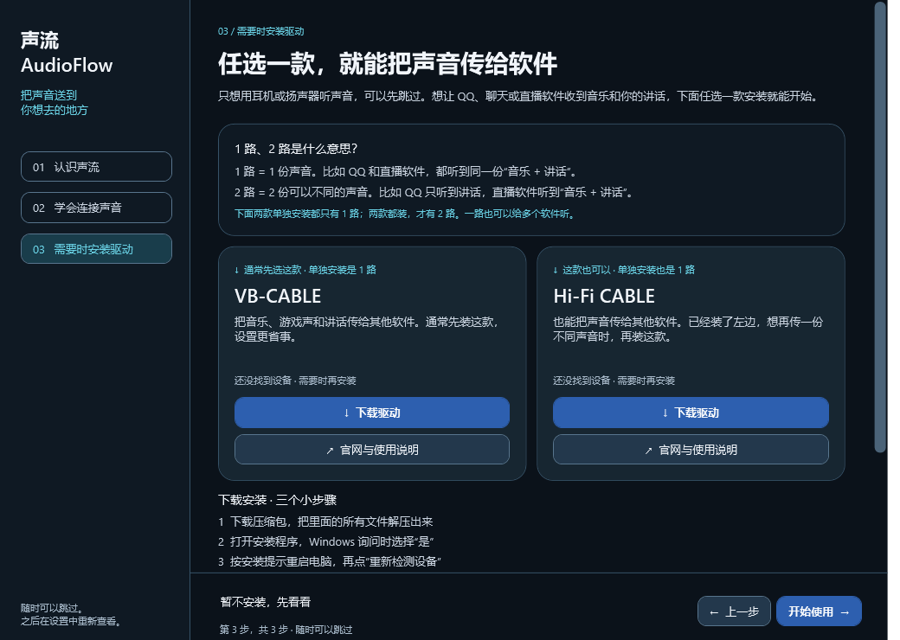

# 声流 AudioFlow

**想在哪听，就把软件连到哪里。**

让音乐软件使用耳机、游戏使用扬声器，或让一个软件同时在多个设备播放。也能把音乐、游戏声和你的讲话，一起传给聊天、录音或直播软件。

适用于 **Windows 11，64 位电脑**。声音和设置都留在你的电脑上。

[下载安装版](https://github.com/16Mu/AudioFlow/releases/download/v0.0.1/AudioFlow-0.0.1-x64.msi) · [下载免安装版](https://github.com/16Mu/AudioFlow/releases/download/v0.0.1/AudioFlow-0.0.1-portable.zip) · [查看全部下载](https://github.com/16Mu/AudioFlow/releases/tag/v0.0.1)

## 软件长什么样

每张卡片代表一个软件或设备。把软件右边的圆点拖到设备左边的圆点，声音就有了去处。下面是一个软件连接两个播放设备的示例。

## 可以拿来做什么

| 你想做的事 | 在声流里怎么安排 |
| --- | --- |
| 音乐用耳机，游戏用扬声器 | 分别为两个软件选择播放设备 |
| 同一份声音在两处播放 | 给同一个软件再连一个播放设备 |
| 让聊天或直播软件收到音乐 | 把音乐软件连到接收软件，再为它选择传声音的麦克风 |
| 把音乐和讲话一起传过去 | 把音乐软件和你的麦克风都连到接收软件 |
| 单独调小某一处声音 | 在那条连接的音量行里调整 |
| 临时恢复原来的声音 | 点击“恢复原设置”，你画的线仍然保留 |

## 下载与打开

当前版本是 [v0.0.1](https://github.com/16Mu/AudioFlow/releases/tag/v0.0.1)。

- **安装版**：下载后双击安装包，按提示安装，再从桌面或开始菜单打开“声流 AudioFlow”。
- **免安装版**：把压缩包里的文件全部解压，打开 portable 文件夹，双击 AudioFlow.exe。
- **第一次使用**：如果电脑还没有所需的微软组件，先[下载并安装 .NET 10 桌面组件](https://aka.ms/dotnet/10.0/windowsdesktop-runtime-win-x64.exe)。只需安装一次。

只想把声音送到耳机或扬声器，可以直接使用。想把音乐或游戏声传给另一款软件，再按下面的说明安装驱动。

## 第一次使用，先在引导里练一次

首次打开会出现引导，介绍软件能做什么、怎么连线、何时需要驱动。可以点“跳过引导，先看看”，以后从设置中重新打开。

引导第二页有可以操作的模拟卡片，练习全程都在引导框内：

1. 点选模拟音乐或视频软件。
2. 右键练习区，添加播放设备卡片。
3. 在卡片里选模拟耳机或扬声器。
4. 把软件右侧的圆点拖到设备左侧的圆点。
5. 点“开启声音连接”，看看模拟声音沿着线移动。

完成后才会开放“下一步”。也可以重新练习或随时跳过。练习中的卡片和声音显示都是模拟的。

正式使用时，先让自己的软件播放声音，再从左边选择它，添加真实设备、拖动圆点连起来，最后开启声音连接。
“设置一个软件”只看当前软件，“查看全部连接”能看所有卡片。两页会一起更新，切换时声音照常。

## 想把音乐传给聊天、录音软件

下面任选一款安装，就能把音乐、游戏声和讲话传给其他软件。

| 选择 | 单独安装能传几份声音 | 下载 |
| --- | --- | --- |
| VB-CABLE | 1 路，通常先选这款 | [官方压缩包](https://download.vb-audio.com/Download_CABLE/VBCABLE_Driver_Pack46.zip) |
| Hi-Fi CABLE | 同样是 1 路；两款都装，才有 2 路 | [官方压缩包](https://download.vb-audio.com/Download_CABLE/HiFiCableAsioBridgeSetup_v1007.zip) |

**1 路 = 1 份声音**，可以同时给多个软件听。比如 QQ 和直播软件，都听到同一份“音乐 + 讲话”。

**2 路 = 2 份可以不同的声音**。比如 QQ 只听到讲话，直播软件听到“音乐 + 讲话”。要这样分别安排，需要把上面两款都装好。

下载后，把压缩包里的文件**全部解压**，再点“安装已下载的驱动…”选择里面的安装程序。Windows 弹出确认窗口时，选择“是”。按安装提示重启电脑后，回到声流点“重新检测设备”。

在接收声音的软件里，把麦克风选为 **CABLE Output** 或 **Hi-Fi Cable Output**。这些是 Windows 里显示的设备名称，选择时保留原名；不要选 Input。

可以先点“暂不安装，先看看”。以后在设置里也能下载、安装和检查设备。驱动由 [VB-Audio 官方](https://vb-audio.com/Cable/)提供，使用和捐赠说明以官网为准。

## 常见问题

**左边没找到软件？** 先让它播放声音，或点“添加软件”搜索，也可以从电脑里选择。

**连好后没声音？** 确认已经开启声音连接、目标设备没有静音、那条线的音量不是 0。接收软件还需要选对麦克风，详见上面的设备名称。

**怎么换掉平时用的耳机？** 在这个软件的“主要播放”卡片里选择另一设备。再添加一张播放设备卡片，则会让声音同时送到另一处。

**怎么断开一条线？** 双击普通连线，或点音量行的“×”。主要播放的线需要保留，换设备时在卡片里选择。

**停止或退出后会怎样？** 声流会恢复原来的声音设置，并保留你画的连接。有些软件需要再次发声、设备需要重新接回后，才能完成恢复。

**设置会丢吗？** 修改会自动保存，也可以用“打开”“保存”“另存为”管理自己的设置文件。

蓝牙设备可能有延迟，少数使用特殊播放方式的软件可能无法把声音转给别处。

## 更多说明

[完整使用说明](docs/使用说明.md) · [更新记录](docs/发布说明.md) · [测试记录](docs/验证报告.md) · [下载源码](https://github.com/16Mu/AudioFlow/releases/download/v0.0.1/AudioFlow-0.0.1-source.zip) · [开发与验证](docs/DEVELOPMENT.md)

声流的自有代码采用 [MIT 许可](LICENSE)。第三方软件的许可见 [THIRD_PARTY_NOTICES.md](THIRD_PARTY_NOTICES.md)。参考项目：[App Audio Router](https://github.com/Eververdants/AppAudioRouter)。
