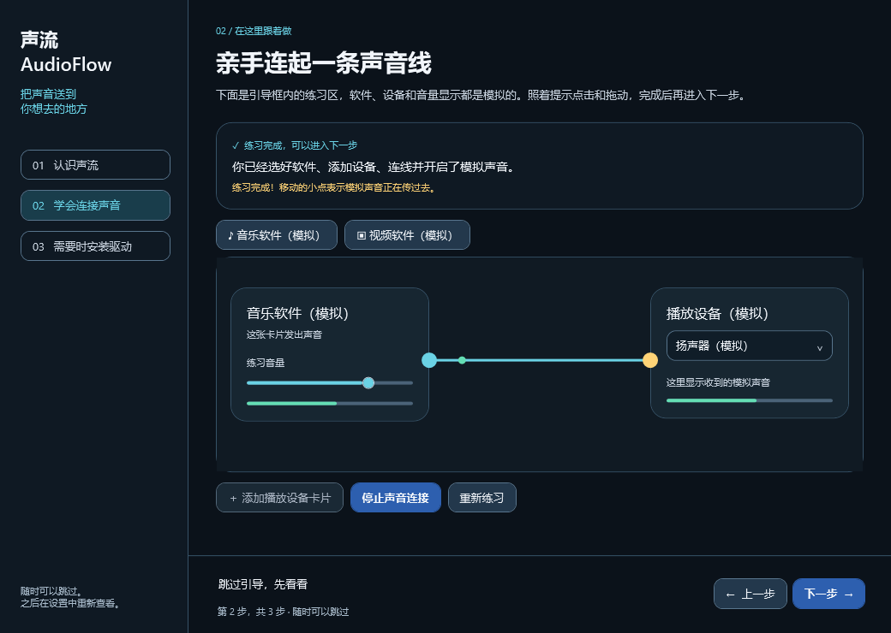
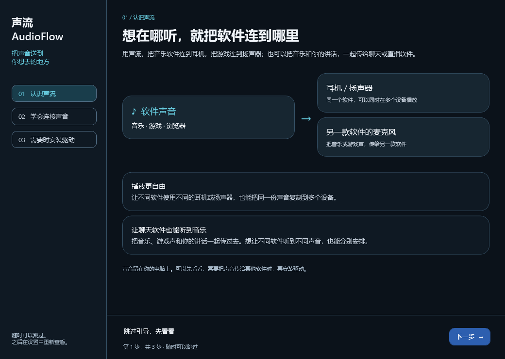
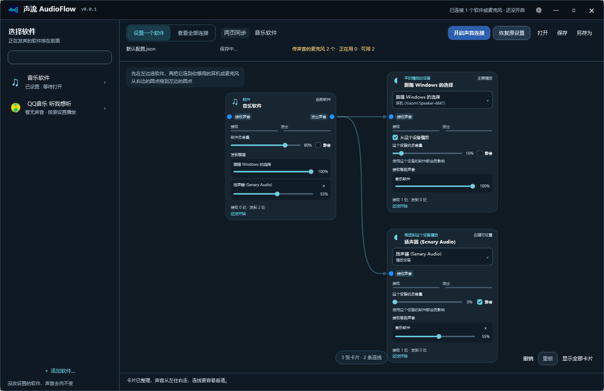
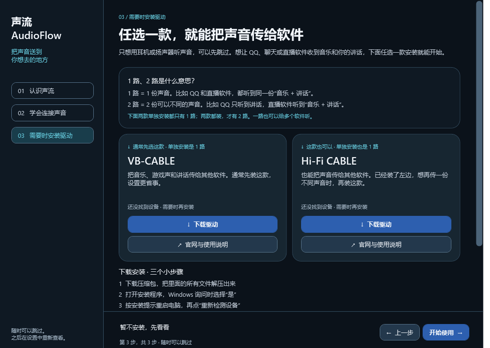
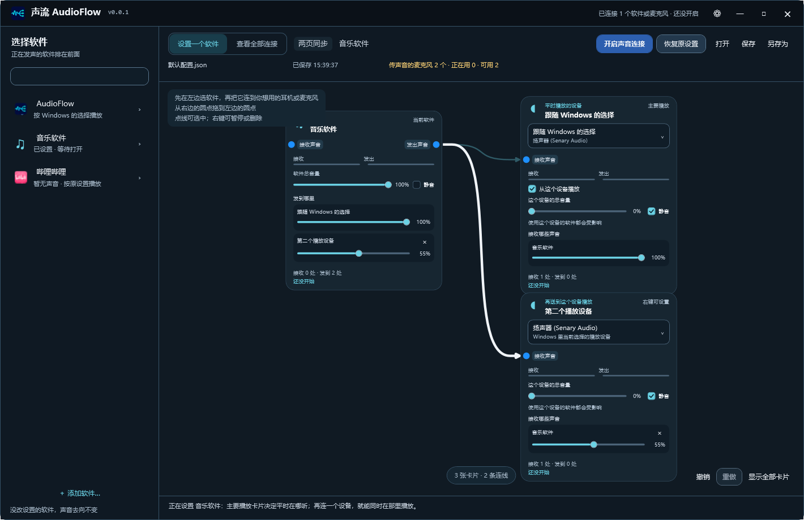

# 声流 AudioFlow v0.0.1 使用说明

声流帮你为每个软件选择声音去向。可以同时送到多个耳机、扬声器，也能把音乐、游戏声和你的讲话，传给聊天、录音或直播软件。

## 下载与打开

适用于 Windows 11 的 64 位电脑。安装版下载后双击打开中文向导，选择安装位置并点击“安装”。完成页面可以勾选“立即打开声流”，也能从桌面或开始菜单打开。免安装版要先解压全部文件，再打开 portable 文件夹里的 AudioFlow.exe。

第一次打开前，需要安装一次[微软 .NET 10 桌面组件](https://aka.ms/dotnet/10.0/windowsdesktop-runtime-win-x64.exe)。已经装好的电脑可以直接打开声流。

首次打开时只显示三步引导，完成或跳过后才进入主界面。可以前后翻页，也能直接点左侧步骤。“跳过引导，先看看”“暂不安装，先看看”“开始使用”或关闭引导，都会记住这次选择。以后从设置里点“查看新手引导”，就能重新查看。

第二页是在引导框内操作的模拟练习。点选模拟软件、添加模拟设备、在卡片里选模拟耳机或扬声器，再拖动两个圆点连线，点“开启声音连接”观察移动的模拟声音。完成后会开放“下一步”。可以重置练习或随时跳过。

练习使用模拟卡片和音量显示；正式使用时，再回到主界面选择自己的软件和设备。

## 先让一个软件在你选的设备播放

1. 让软件开始播放声音，再从声流左边选择它。没找到时，点“添加软件”搜索，或从电脑中选择。
2. 软件会有一张“主要播放”卡片，表示它平时从哪里播放。选择具体耳机、扬声器，或选“跟随 Windows 的选择”。
3. 想同时在另一设备播放，在中间空白处点右键，添加播放设备卡片，再选好设备。
4. 从软件右边的圆点，拖到目标左边的圆点。
5. 点右上角“开启声音连接”。

切换耳机时，在主要播放卡片里更换即可。选择“不播放声音”或取消“从这个设备播放”，会关闭这一处，其他连线仍可使用。重新开启后，设备和音量保持原样。

“设置一个软件”只看当前软件及相关设备，“查看全部连接”能看到所有卡片。两页是同一份设置，切换时声音照常。

## 把声音传给聊天、录音或直播软件

只调整耳机、扬声器的播放去向时，可以直接使用。要让另一款软件把音乐或游戏声当作麦克风声音接收，需要安装下面的驱动。

- [VB-CABLE 官方压缩包](https://download.vb-audio.com/Download_CABLE/VBCABLE_Driver_Pack46.zip)：单独安装是 1 路，通常先选这款。
- [Hi-Fi CABLE 官方压缩包](https://download.vb-audio.com/Download_CABLE/HiFiCableAsioBridgeSetup_v1007.zip)：单独安装同样是 1 路；两款都装，才有 2 路。发送和接收设备在 Windows 中选择的声音格式需要一致。

1 路是一份声音，可以同时给多个软件听。例如 QQ 和直播软件都听到同样的“音乐 + 讲话”。
2 路是两份可以不同的声音。例如 QQ 只听到讲话，直播软件听到“音乐 + 讲话”。
要把声音传给其他软件，上面任选一款即可；要同时传两份不同的声音，再把另一款也装好。

在引导或设置里点“下载驱动”，把压缩包里的文件**全部解压**。再点“安装已下载的驱动…”，选择 VBCABLE_Setup_x64.exe 或 HiFiCableAsioBridgeSetup.exe。Windows 弹出确认窗口时，选择“是”。也可以自己右键安装程序，选择“以管理员身份运行”。

完成安装、按提示重启电脑后，点“重新检测设备”。已经找到的设备会显示“不用重复安装”。

接下来添加接收软件，把音乐软件或你的麦克风连到它。在接收软件里，将麦克风选为 **CABLE Output 或 Hi-Fi Cable Output**。这些是设备原名；不要选 Input。选择固定麦克风的软件，可能需要自己在软件里更换，或重新开启录音。

共用同一个传声音麦克风的软件，会听到同样的声音。想分别传不同声音，需要分别使用不同的麦克风。可用的已经用完时，声流会让你选择共用、腾出一个，或再添加驱动。

驱动由 [VB-Audio 官方](https://vb-audio.com/Cable/)提供，具体使用与捐赠说明见官网。可以先跳过，以后再从设置里下载和安装。

## 调音量、静音和移动连线

- **软件总音量／麦克风总音量**：调整这张卡片往外传的所有声音。
- **“发到哪里”“接收哪些声音”中的音量**：只调整对应的那条线，两端显示的是同一个音量。
- **这个设备的总音量**：和 Windows 里这个设备的音量一致，使用它的其他软件也会受影响。
- **静音**：关掉相应的声音，再取消勾选即可恢复。
- **选中连线**：点一下线，它会变亮、变粗，方便看清连接的两端。
- **暂时停用一条线**：右键选“暂停这条连接”。线会变成虚线，音量会保留。右键选“重新开启”可以恢复。
- **断开普通连线**：右键选“删除这条线”，也可以双击线，或点音量行的“×”。删错后点“撤销”找回来。
- **换个声音去处**：拖动接收卡片左边的圆点，放到新的左侧圆点；松在空白处会断开，按 Esc 可以放回原处。有多条线时，先点选要移动的那条。

当前软件、主要播放卡片和它们之间的线需要保留。更换设备时，在卡片里选择即可。

传声音的麦克风连到软件时，暂停或删除这条线会让这个软件暂时不接收声音，需要留出一个空着的传声音设备。没有可用设备时会提示你，原来的连接会保留，其他软件继续使用。

关掉的连接会显示虚线和红色“×”，开启后恢复正常。点“整理卡片”能让连线更容易看清；“显示全部卡片”能把所有卡片显示出来。

## 选择软件使用的麦克风

正在使用麦克风的软件会显示“这个软件用的麦克风”。也可以右键软件卡片，选择同名操作。

可以选真实麦克风、能传软件声音的麦克风，或跟随 Windows 的选择。

“不接收声音”会让这个软件听不到声音，需要留出一个空着的传声音设备来完成。没有可用设备时，声流会提示你腾出一个，或安装更多驱动；其他软件的录音会继续工作。

停止声音连接、退出或点“恢复原设置”后，软件会尝试恢复原来的麦克风选择。

## 保存、停止与退出

连线、音量和静音的修改会自动保存。用“打开”“保存”“另存为”可以管理自己的声音设置文件，下次继续使用。

原文件打不开或找不到时，声流会保留它，并尝试找回上次的设置。请重新选择文件，或将找回的设置另存为新文件。

“停止声音连接”会停止按连线播放，并恢复软件原来的声音去向。点“恢复原设置”还会恢复声流改过的设备音量、静音等。你画的线和音量设置会保留。

关闭窗口通常会退出并恢复声音。想关闭窗口后继续使用，可以在设置里勾选相应选项，再从任务栏右下角的声流图标打开。

想开机后自动打开，在设置里勾选“开机后自动打开声流”。默认没有开启，可以随时取消。再勾选“下次打开时接着使用上次的连接与开启／停止状态”，登录 Windows 后就能继续上次的声音安排。

已经关闭的软件需要再次发声、拔掉的设备需要重新接回，才能完成部分恢复。声流会保留待恢复的设置，并继续尝试。电脑重启后，再打开声流也会继续处理。

## 没有声音时，按顺序检查

1. 来源软件是否已经在播放声音？
2. 是否点了“开启声音连接”？
3. 设备是否接好，是否被静音，音量是否为 0？
4. 线是否连到了正确的卡片？
5. 接收软件是否选了 CABLE Output 或 Hi-Fi Cable Output 作为麦克风？

更换设备后，少数软件需要重新打开或重新开启录音。蓝牙设备可能有延迟，少数软件有自己的特殊播放方式，可能无法在声流里把声音转给别处。

## 设置保存在什么地方

通常在电脑的 %LOCALAPPDATA%\AudioFlow 文件夹里。卸载会保留设置，重新安装后可以继续使用。

声音不会上传，也不会默认保存录音。首次引导的已看记录和声音设置分别保存，打开别的设置文件不会让引导重新弹出。

更多技术和测试信息见 [开发与验证](DEVELOPMENT.md)。
